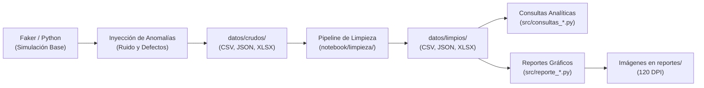

# Plataforma de Innovación Abierta — Pipeline ETL, Calidad de Datos y Analítica

> **Proyecto Integrador de Nuevas Tecnologías**  
> **Curso:** Sabatino 2026-2 / Grupo 4  
> **Tecnologías:** Python 3, Pandas, Matplotlib, Faker, OpenpyXL, Git  

---

## 📌 1. Descripción General del Proyecto

Este repositorio contiene la arquitectura completa de ingeniería y análisis de datos para una **Plataforma de Innovación Abierta**, orientada a conectar empresas que plantean retos estratégicos con estudiantes y proponentes que postulan soluciones.

El proyecto implementa un ciclo de vida de datos de extremo a extremo (ETL):
1. **Generación sintética con ensuciado intencional:** Empleo de `Faker` y `Pandas` para simular escenarios reales de producción con anomalías de datos (duplicados, formatos de fecha cruzados, nulos, casing irregular e inconsistencias de fechas lógicas).
2. **Saneamiento y Normalización:** Rutinas automatizadas de limpieza para estandarizar formatos, eliminar redundancias y enriquecer los datos con métricas analíticas.
3. **Exportación Multi-fuente:** Persistencia sincronizada en formatos **CSV** (con separador `;` y codificación UTF-8 con BOM), **JSON** (registros indentados) y **Excel** (`.xlsx`).
4. **Consultas Analíticas y de Negocio:** Scripts dedicados con consultas avanzadas usando agregaciones `groupby`, filtros booleanos y matrices cruzadas (`unstack`).
5. **Visualización y Reportes Gráficos:** Generación automatizada de gráficos de alta resolución (120 DPI) con `matplotlib` y deducción de conclusiones para la toma de decisiones y el diseño del backend.

---

## 🏛️ 2. Arquitectura de Directorios

```text
integrador_nt_sabado20262_4/
│
├── .venv/                              # Entorno virtual de Python
│
├── datos/                              # Única carpeta de datos del proyecto
│   ├── crudos/                         # Datasets con defectos inyectados (CSV, JSON, XLSX)
│   └── limpios/                        # Datasets depurados y resultados de consultas (CSV, JSON, XLSX)
│
├── notebook/
│   ├── simulaciones/                   # Generación sintética y ensuciado de datos (Faker)
│   │   ├── comun.py                    # Semilla, fecha de referencia e ids deterministas compartidos
│   │   ├── simulacion_usuario.py
│   │   ├── simulacion_empresa.py
│   │   ├── simulacion_categorias.py
│   │   ├── simulacion_prioridades.py
│   │   ├── simulacion_retos.py
│   │   └── simulacion_registros.py
│   │
│   ├── limpieza/                       # Reglas de limpieza, saneamiento y normalización
│   │   ├── simulacion_usuario.py
│   │   ├── simulacion_empresa.py
│   │   ├── simulacion_categorias.py
│   │   ├── simulacion_prioridades.py
│   │   ├── simulacion_retos.py
│   │   └── simulacion_registros.py
│   │
│   └── exportacion/                    # Rutina centralizada para exportación a CSV, JSON y XLSX
│       └── exportacion.py
│
├── src/                                # Scripts de análisis y generación de reportes
│   ├── consultas_empresas.py           # 5 consultas analíticas sobre empresas
│   ├── reporte_empresas.py             # 3 visualizaciones + conclusiones de empresas
│   ├── consultas_prioridades.py        # 5 consultas analíticas sobre prioridades y SLAs
│   ├── reporte_prioridades.py          # 3 visualizaciones + conclusiones de prioridades
│   ├── consultas_retos.py              # 5 consultas analíticas sobre retos y duración
│   ├── reporte_retos.py                # 3 visualizaciones + conclusiones de retos
│   ├── consultas_categorias.py         # 5 consultas analíticas sobre categorías temáticas
│   ├── reporte_categorias.py           # 3 visualizaciones + conclusiones de categorías
│   ├── consultas_registros.py          # 5 consultas analíticas sobre inscripciones
│   └── reporte_registros.py            # 3 visualizaciones + conclusiones de inscripciones
│
├── reportes/                           # Visualizaciones generadas en formato PNG (120 DPI)
│   ├── empresas_grafica_1.png          # Barras: empresas por sector económico
│   ├── empresas_grafica_2.png          # Torta: proporción activas vs inactivas
│   ├── empresas_grafica_3.png          # Barras apiladas: estado por sector
│   ├── prioridades_grafica_1.png       # Barras: cantidad de registros por nivel de prioridad
│   ├── prioridades_grafica_2.png       # Barras: días promedio de respuesta por prioridad
│   ├── prioridades_grafica_3.png       # Torta: reparto proporcional de prioridades
│   ├── retos_grafica_1.png             # Barras: retos por estado operativo
│   ├── retos_grafica_2.png             # Línea: tendencia de retos iniciados por mes
│   ├── retos_grafica_3.png             # Histograma: distribución de la duración en días
│   ├── categorias_grafica_1.png        # Barras horizontales: frecuencia por categoría
│   ├── categorias_grafica_2.png        # Torta: reparto de categorías por área responsable
│   ├── categorias_grafica_3.png        # Barras: largo promedio de descripciones
│   ├── registros_grafica_1.png         # Barras: participaciones por estado
│   ├── registros_grafica_2.png         # Línea: evolución mensual de inscripciones
│   └── registros_grafica_3.png         # Barras horizontales: top 10 retos más demandados
│
├── main.py                             # Orquestador del pipeline completo ETL
├── requirements.txt                    # Dependencias del proyecto
└── README.md                           # Documentación técnica
```

---

## 🧩 3. Modelo de Entidades y Dominio

El modelo de datos cubre 6 entidades esenciales del ecosistema:

| Entidad | Descripción de Negocio | Volumen Simulado | Defectos Clave Inyectados |
| :--- | :--- | :---: | :--- |
| **Usuario** | Proponentes y evaluadores con roles (`ADMIN`, `EMPRESA`, `ESTUDIANTE`, `DOCENTE`). | 250 filas | Emails sin arroba `@`, nombres con espacios extra, duplicados de ID. |
| **Empresa** | Organizaciones que publican retos clasificadas por sector y estado de actividad. | 300 filas | Casing inconsistente en sector, booleanos mixtos (`'SI'`, `'1'`), correos inválidos. |
| **Categorías** | Catálogo temático de retos vinculado a un área responsable funcional. | 250 filas | Descripciones nulas, casing irregular en títulos, duplicados exactos. |
| **Prioridades** | Acuerdos de Nivel de Servicio (SLA) con niveles de severidad (1 a 5). | 200 filas | Variantes semánticas de casing, niveles en texto (`'tres'`), valores fuera de rango (`999`). |
| **Retos** | Desafíos de innovación con fechas de vigencia y estado de ciclo de vida. | 500 filas | Mezcla de formatos de fecha (ISO vs DD/MM/YYYY), fechas de fin anteriores a inicio, estados no normalizados. |
| **Registros** | Asignaciones o postulaciones de usuarios a retos específicos. | 800 filas | Duplicidad de pares `(id_usuario, id_reto)`, formatos de fecha heterogéneos, estados mixtos. |

### Relaciones entre entidades

Las llaves foráneas apuntan a registros que existen realmente en las otras tablas:

| Llave foránea | Tabla referenciada | Integridad en datos limpios |
| :--- | :--- | :---: |
| `retos.id_empresa` | `empresa.id` | 97.6 % |
| `retos.id_categoria` | `categoria.id` | 100 % |
| `retos.id_prioridad` | `prioridades.id` | 100 % |
| `registros.id_usuario` | `usuario.id` | 100 % |
| `registros.id_reto` | `retos.id` | 100 % |

El 2.4 % restante de `retos.id_empresa` corresponde a empresas que la limpieza elimina por tener un NIT repetido; esos retos quedan huérfanos y son un hallazgo de calidad de datos.

### Reproducibilidad

Cada ejecución de `python main.py --limpiar` produce exactamente los mismos datos. [`notebook/simulaciones/comun.py`](notebook/simulaciones/comun.py) centraliza lo necesario:
- **Semilla fija (`SEMILLA = 42`)**, que se reinicia al comenzar la generación de cada tabla, de modo que el resultado no depende del orden de ejecución.
- **Identificadores deterministas:** `generar_id(entidad, indice)` usa `uuid5`, así que el id de cada fila es siempre el mismo y las demás tablas pueden referenciarlo.
- **Fecha de referencia fija (`FECHA_REFERENCIA = 2026-10-31`)**: las fechas simuladas se calculan respecto a ella y no respecto al día en que se ejecuta el script.

---

## ⚙️ 4. Pipeline ETL y Calidad de Datos



### Reglas Principales de Saneamiento:
- **Deduplicación:** Eliminación de duplicados exactos por identificador primario (`id`).
- **Normalización de Texto:** Limpieza de espacios redundantes (`.strip()`), unificación a mayúsculas snake_case para estados (`EN_CURSO`, `FINALIZADO`, `ACTIVO`) y capitalización homogénea para nombres y categorías.
- **Estandarización Temporal:** Parseo robusto con `pd.to_datetime(..., format="mixed", dayfirst=True)` a formato estándar `YYYY-MM-DD` y corrección de fechas de fin anteriores al inicio.
- **Enriquecimiento de Métricas:**
  - `duracion_dias`: Calculado como `(fecha_fin - fecha_inicio).dt.days`.
  - `largo_desc`: Longitud en caracteres de las descripciones textuales.
  - `mes`: Período mensual estandarizado `YYYY-MM` para análisis temporal.

---

## 📊 5. Módulos de Consultas Analíticas (`src/`)

Cada script de consultas lee su respectivo archivo limpio en `datos/limpios/` (`empresa_limpio.csv`, `prioridades_limpio.csv`, `retos_limpio.csv`, `categoria_limpio.csv` y `registros_limpio.csv`), resuelve 5 preguntas de negocio mediante funciones individuales, imprime los resultados ordenados en consola y exporta cada respuesta en un archivo CSV independiente dentro de esa misma carpeta:

### 1. Empresas ([`src/consultas_empresas.py`](src/consultas_empresas.py))
- `empresas_consulta_1.csv`: Empresas activas (`df["activa"] == True`).
- `empresas_consulta_2.csv`: Empresas de un sector específico ordenadas alfabéticamente.
- `empresas_consulta_3.csv`: Conteo rápido por sector económico (`value_counts()`).
- `empresas_consulta_4.csv`: `groupby("sector")` ordenado descendentemente.
- `empresas_consulta_5.csv`: `groupby(["sector", "activa"])` con `unstack(fill_value=0)`.

### 2. Prioridades ([`src/consultas_prioridades.py`](src/consultas_prioridades.py))
- `prioridades_consulta_1.csv`: Prioridades ordenadas por nivel ascendente (urgencia).
- `prioridades_consulta_2.csv`: Prioridades altamente urgentes (`nivel <= 2`).
- `prioridades_consulta_3.csv`: Frecuencia de aparición por nombre de prioridad.
- `prioridades_consulta_4.csv`: `groupby("nivel")` para contar registros por nivel numérico.
- `prioridades_consulta_5.csv`: `groupby("nombre")` con métricas múltiples (`min`, `mean`, `max`) de días máximos de respuesta.

### 3. Retos ([`src/consultas_retos.py`](src/consultas_retos.py))
- `retos_consulta_1.csv`: Retos con estado `'EN_CURSO'`.
- `retos_consulta_2.csv`: Los 10 retos de mayor duración mediante `nlargest(10, "duracion_dias")`.
- `retos_consulta_3.csv`: Conteo de retos por estado operativo.
- `retos_consulta_4.csv`: `groupby("estado")` agregando `count`, `mean` y `max` de duración.
- `retos_consulta_5.csv`: `groupby` por período mensual (`fecha_inicio.dt.to_period("M")`).

### 4. Categorías ([`src/consultas_categorias.py`](src/consultas_categorias.py))
- `categorias_consulta_1.csv`: Frecuencia por nombre de categoría consolidada.
- `categorias_consulta_2.csv`: Categorías marcadas con `'Sin descripcion'`.
- `categorias_consulta_3.csv`: `groupby("nombre")` del largo promedio de la descripción (`largo_desc`).
- `categorias_consulta_4.csv`: `groupby("area_responsable")` ordenado descendentemente.
- `categorias_consulta_5.csv`: `groupby` doble de categorías por área con tabla cruzada (`unstack`).

### 5. Registros ([`src/consultas_registros.py`](src/consultas_registros.py))
- `registros_consulta_1.csv`: Participaciones finalizadas (`estado == "FINALIZADO"`).
- `registros_consulta_2.csv`: Detección de inscripciones duplicadas por usuario y reto (`subset=["id_usuario", "id_reto"]`).
- `registros_consulta_3.csv`: Conteo de participaciones por estado.
- `registros_consulta_4.csv`: `groupby("id_reto")` con el top 10 de retos más demandados (`nlargest(10)`).
- `registros_consulta_5.csv`: `groupby("mes")` con la evolución histórica de inscripciones.

---

## 📈 6. Reportes Gráficos y Hallazgos de Negocio

Cada módulo de reporte (`src/reporte_*.py`) genera 3 figuras visuales en `reportes/` cumpliendo estrictamente con:
- Títulos descriptivos (`plt.title`).
- Etiquetas claras en ambos ejes (`plt.xlabel`, `plt.ylabel`).
- Optimización de espacio (`plt.tight_layout()`).
- Resolución estándar de 120 DPI (`plt.savefig(..., dpi=120)`).
- Cierre sin bloqueo de ejecución (`plt.close()`).

### Conclusiones y Aprendizajes Clave:

Las cifras de las conclusiones que imprime cada reporte se calculan en cada ejecución a partir de `datos/limpios/` y `datos/crudos/`; no están escritas a mano en el código. Los valores siguientes corresponden a los datos actuales del repositorio:

1. **Empresas ([`src/reporte_empresas.py`](src/reporte_empresas.py))**:
   - **Sector líder:** Tecnología (60 empresas), seguido por Retail (51) y Alimentos (50).
   - **Tasa de inactividad:** El 49.8% de las empresas (145 de 291) se encuentra inactivo, lo que alerta sobre fricciones en el proceso de incorporación (*onboarding*) y la necesidad de campañas de reactivación.
   - **Correos malformados:** 18 de las 300 empresas crudas (6.0%) tenían correos sin `@` o nulos. Es crítico validarlos en el Backend mediante expresiones regulares y DTOs para no arruinar la reputación del servidor de correos (SMTP).

2. **Prioridades ([`src/reporte_prioridades.py`](src/reporte_prioridades.py))**:
   - **Consolidación:** Se depuraron las variantes de escritura y quedaron las 5 prioridades canónicas del negocio (`muy baja`, `baja`, `media`, `alta`, `critica`).
   - **Relación SLA:** Relación inversa entre nivel y tiempo máximo: Nivel 1 (10 días), Nivel 2 (7), Nivel 3 (5), Nivel 4 (2) y Nivel 5 (1 día).
   - **Anomalías detectadas:** En el crudo aparecieron 14 niveles nulos, 15 niveles escritos como texto (`'tres'`, `'cinco'`), 8 días de respuesta nulos y 6 valores absurdos (`999`).
   - **Validación Backend:** El campo `nivel` debe restringirse a un entero en el rango `[1, 5]` para evitar que solicitudes urgentes queden sin plazo o generen errores en los dashboards.

3. **Retos ([`src/reporte_retos.py`](src/reporte_retos.py))**:
   - **Estacionalidad:** El mayor pico de apertura de retos fue en 2026-01 (50 retos), seguido por 2026-10 (41) y 2025-12 (40).
   - **Duración media:** Los retos cerrados promedian 80 días (~2.7 meses). Los promedios más altos son los de los estados `ACTIVO` (92.9 días) y `BLOQUEADO` (90.5 días).
   - **Fechas invertidas:** En el crudo se detectaron 25 retos (de 500) con fecha de fin anterior o igual a la de inicio y 38 sin fecha de fin. El backend debe aplicar un validador de integridad `CHECK (fecha_fin > fecha_inicio)`.

4. **Categorías ([`src/reporte_categorias.py`](src/reporte_categorias.py))**:
   - **Unicidad:** Se eliminaron 12 filas duplicadas (de 262 a 250), se corrigieron 61 nombres mal escritos y se estandarizaron 38 descripciones nulas. Quedaron 12 categorías temáticas oficiales.
   - **Integridad:** El campo `nombre` debe declararse como `UNIQUE` en la base de datos para impedir que los administradores registren sinónimos o variantes que dispersen las búsquedas de los estudiantes.

5. **Registros ([`src/reporte_registros.py`](src/reporte_registros.py))**:
   - **Demanda:** Las 800 inscripciones se reparten entre 384 retos distintos; el reto más demandado tiene 7 participantes, así que la demanda está bastante distribuida. El mes con más inscripciones fue 2026-04 (77).
   - **Control de Duplicados y HTTP 409:** Se detectaron 76 inscripciones redundantes del mismo usuario en el mismo reto (152 filas involucradas). Cuando un usuario intente postularse más de una vez al mismo reto, la API debe rechazar la solicitud con `HTTP 409 Conflict` para evitar dobles calificaciones o cupos ficticios.

---

## 🚀 7. Guía de Instalación y Uso

### 7.1. Requisitos Previos
- Python 3.10 o superior instalado en el sistema.
- Gestor de paquetes `pip`.

### 7.2. Configuración del Entorno Virtual

En Windows (PowerShell):
```powershell
# 1. Clonar el repositorio y ubicarse en la carpeta
cd integrador_nt_sabado20262_4

# 2. Crear el entorno virtual si no existe
python -m venv .venv

# 3. Activar el entorno virtual
.\.venv\Scripts\Activate.ps1

# 4. Instalar las dependencias requeridas
pip install -r requirements.txt
```

### 7.3. Ejecución del Pipeline ETL Orquestado

```powershell
# Generar datos simulados, ensuciar y exportar a 'datos/crudos/':
python main.py

# Generar datos crudos y ejecutar inmediatamente la fase de limpieza hacia 'datos/limpios/':
python main.py --limpiar
```

### 7.4. Ejecución de Consultas Analíticas

```powershell
python src/consultas_empresas.py
python src/consultas_prioridades.py
python src/consultas_retos.py
python src/consultas_categorias.py
python src/consultas_registros.py
```

### 7.5. Generación de Reportes Gráficos

```powershell
python src/reporte_empresas.py
python src/reporte_prioridades.py
python src/reporte_retos.py
python src/reporte_categorias.py
python src/reporte_registros.py
```

---

## 🛡️ 8. Buenas Prácticas y Calidad de Código Implementadas

- **Aislamiento de Entorno:** Configuración explícita de `MPLCONFIGDIR` en directorios temporales para evitar fallos de permisos en entornos de ejecución automatizados o contenedores.
- **Rutas Agnósticas:** Uso intensivo de `pathlib.Path` para garantizar compatibilidad multiplataforma (Windows, Linux, macOS).
- **Tipado Estático y Docstrings:** Todas las funciones disponen de anotaciones de tipo y descripciones estructuradas.
- **Idempotencia y reproducibilidad:** Scripts reejecutables que producen exactamente los mismos datos en cada ejecución (semilla, ids `uuid5` y fecha de referencia fijos).
- **Versionado Seguro:** Todos los artefactos de datos limpios, scripts y reportes se encuentran gestionados y auditados en Git.

---

## 👨‍💻 Autoría y Colaboración
- **Proyecto Integrador:** Nuevas Tecnologías — CESDE
- **Rama de Trabajo:** `feature/E4EMPF01`
