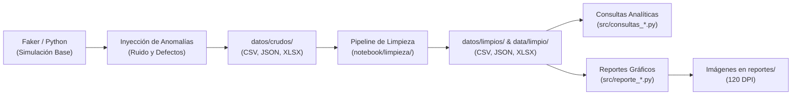

# Plataforma de Innovación Abierta — Pipeline ETL, Calidad de Datos y Analítica

> **Proyecto Integrador de Nuevas Tecnologías**  
> **Curso:** Sabatino 2026-2 / Grupo 4  
> **Tecnologías:** Python 3, Pandas, Matplotlib, Faker, OpenpyXL, Git  

---

## 📌 1. Descripción General del Proyecto

Este repositorio contiene la arquitectura completa de ingeniería y análisis de datos para una **Plataforma de Innovación Abierta**, orientada a conectar empresas que plantean retos estratégicos con estudiantes y proponentes que postulan soluciones.

El proyecto implementa un ciclo de vida de datos de extremo a extremo (ETL):
1. **Generación sintética con ensuciado intencional:** Empleo de `Faker` y `Pandas` para simular escenarios reales de producción con anomalías de datos (duplicados, formatos de fecha cruzados, nulos, casing irregular e inconsistencias de fechas lógicas).
2. **Saneamiento y Normalización:** Rutinas automatizadas de limpieza para estandarizar formatos, eliminar redundancias y enriquecer los datos con métricas analíticas.
3. **Exportación Multi-fuente:** Persistencia sincronizada en formatos **CSV** (con separador `;` y codificación UTF-8 con BOM), **JSON** (registros indentados) y **Excel** (`.xlsx`).
4. **Consultas Analíticas y de Negocio:** Scripts dedicados con consultas avanzadas usando agregaciones `groupby`, filtros booleanos y matrices cruzadas (`unstack`).
5. **Visualización y Reportes Gráficos:** Generación automatizada de gráficos de alta resolución (120 DPI) con `matplotlib` y deducción de conclusiones para la toma de decisiones y el diseño del backend.

---

## 🏛️ 2. Arquitectura de Directorios

```text
integrador_nt_sabado20262_4/
│
├── .venv/                              # Entorno virtual de Python
│
├── datos/                              # Almacenamiento primario estructurado
│   ├── crudos/                         # Datasets con defectos inyectados (CSV, JSON, XLSX)
│   └── limpios/                        # Datasets depurados y resultados de consultas (CSV, JSON, XLSX)
│
├── data/
│   └── limpio/                         # Espejo de datos limpios y salidas de consultas analíticas
│
├── notebook/
│   ├── simulaciones/                   # Generación sintética y ensuciado de datos (Faker)
│   │   ├── simulacion_usuario.py
│   │   ├── simulacion_empresa.py
│   │   ├── simulacion_categorias.py
│   │   ├── simulacion_prioridades.py
│   │   ├── simulacion_retos.py
│   │   └── simulacion_registros.py
│   │
│   ├── limpieza/                       # Reglas de limpieza, saneamiento y normalización
│   │   ├── simulacion_usuario.py
│   │   ├── simulacion_empresa.py
│   │   ├── simulacion_categorias.py
│   │   ├── simulacion_prioridades.py
│   │   ├── simulacion_retos.py
│   │   └── simulacion_registros.py
│   │
│   └── exportacion/                    # Rutina centralizada para exportación a CSV, JSON y XLSX
│       └── exportacion.py
│
├── src/                                # Scripts de análisis y generación de reportes
│   ├── consultas_empresas.py           # 5 consultas analíticas sobre empresas
│   ├── reporte_empresas.py             # 3 visualizaciones + conclusiones de empresas
│   ├── consultas_prioridades.py        # 5 consultas analíticas sobre prioridades y SLAs
│   ├── reporte_prioridades.py          # 3 visualizaciones + conclusiones de prioridades
│   ├── consultas_retos.py              # 5 consultas analíticas sobre retos y duración
│   ├── reporte_retos.py                # 3 visualizaciones + conclusiones de retos
│   ├── consultas_categorias.py         # 5 consultas analíticas sobre categorías temáticas
│   ├── reporte_categorias.py           # 3 visualizaciones + conclusiones de categorías
│   ├── consultas_registros.py          # 5 consultas analíticas sobre inscripciones
│   └── reporte_registros.py            # 3 visualizaciones + conclusiones de inscripciones
│
├── reportes/                           # Visualizaciones generadas en formato PNG (120 DPI)
│   ├── empresas_grafica_1.png          # Barras: empresas por sector económico
│   ├── empresas_grafica_2.png          # Torta: proporción activas vs inactivas
│   ├── empresas_grafica_3.png          # Barras apiladas: estado por sector
│   ├── prioridades_grafica_1.png       # Barras: cantidad de registros por nivel de prioridad
│   ├── prioridades_grafica_2.png       # Barras: días promedio de respuesta por prioridad
│   ├── prioridades_grafica_3.png       # Torta: reparto proporcional de prioridades
│   ├── retos_grafica_1.png             # Barras: retos por estado operativo
│   ├── retos_grafica_2.png             # Línea: tendencia de retos iniciados por mes
│   ├── retos_grafica_3.png             # Histograma: distribución de la duración en días
│   ├── categorias_grafica_1.png        # Barras horizontales: frecuencia por categoría
│   ├── categorias_grafica_2.png        # Torta: reparto de categorías por área responsable
│   ├── categorias_grafica_3.png        # Barras: largo promedio de descripciones
│   ├── registros_grafica_1.png         # Barras: participaciones por estado
│   ├── registros_grafica_2.png         # Línea: evolución mensual de inscripciones
│   └── registros_grafica_3.png         # Barras horizontales: top 10 retos más demandados
│
├── main.py                             # Orquestador del pipeline completo ETL
├── requirements.txt                    # Dependencias del proyecto
└── README.md                           # Documentación técnica
```

---

## 🧩 3. Modelo de Entidades y Dominio

El modelo de datos cubre 6 entidades esenciales del ecosistema:

| Entidad | Descripción de Negocio | Volumen Simulado | Defectos Clave Inyectados |
| :--- | :--- | :---: | :--- |
| **Usuario** | Proponentes y evaluadores con roles (`ADMIN`, `EMPRESA`, `ESTUDIANTE`, `DOCENTE`). | 500 filas | Emails sin arroba `@`, nombres con espacios extra, duplicados de ID. |
| **Empresa** | Organizaciones que publican retos clasificadas por sector y estado de actividad. | 300 filas | Casing inconsistente en sector, booleanos mixtos (`'SI'`, `'1'`), correos inválidos. |
| **Categorías** | Catálogo temático de retos vinculado a un área responsable funcional. | 250 filas | Descripciones nulas, casing irregular en títulos, duplicados exactos. |
| **Prioridades** | Acuerdos de Nivel de Servicio (SLA) con niveles de severidad (1 a 5). | 200 filas | Variantes semánticas de casing, niveles en texto (`'tres'`), valores fuera de rango (`999`). |
| **Retos** | Desafíos de innovación con fechas de vigencia y estado de ciclo de vida. | 500 filas | Mezcla de formatos de fecha (ISO vs DD/MM/YYYY), fechas de fin anteriores a inicio, estados no normalizados. |
| **Registros** | Asignaciones o postulaciones de usuarios a retos específicos. | 800 filas | Duplicidad de pares `(id_usuario, id_reto)`, formatos de fecha heterogéneos, estados mixtos. |

---

## ⚙️ 4. Pipeline ETL y Calidad de Datos



### Reglas Principales de Saneamiento:
- **Deduplicación:** Eliminación de duplicados exactos por identificador primario (`id`).
- **Normalización de Texto:** Limpieza de espacios redundantes (`.strip()`), unificación a mayúsculas snake_case para estados (`EN_CURSO`, `FINALIZADO`, `ACTIVO`) y capitalización homogénea para nombres y categorías.
- **Estandarización Temporal:** Parseo robusto con `pd.to_datetime(..., format="mixed", dayfirst=True)` a formato estándar `YYYY-MM-DD` y corrección de fechas de fin anteriores al inicio.
- **Enriquecimiento de Métricas:**
  - `duracion_dias`: Calculado como `(fecha_fin - fecha_inicio).dt.days`.
  - `largo_desc`: Longitud en caracteres de las descripciones textuales.
  - `mes`: Período mensual estandarizado `YYYY-MM` para análisis temporal.

---

## 📊 5. Módulos de Consultas Analíticas (`src/`)

Cada script de consultas lee su respectivo archivo limpio en `data/limpio/`, resuelve 5 preguntas de negocio mediante funciones individuales, imprime los resultados ordenados en consola y exporta cada respuesta en un archivo CSV independiente:

### 1. Empresas ([`src/consultas_empresas.py`](file:///d:/CESDE/Nuevas_Tecnologias/integrador_nt_sabado20262_4/src/consultas_empresas.py))
- `empresas_consulta_1.csv`: Empresas activas (`df["activa"] == True`).
- `empresas_consulta_2.csv`: Empresas de un sector específico ordenadas alfabéticamente.
- `empresas_consulta_3.csv`: Conteo rápido por sector económico (`value_counts()`).
- `empresas_consulta_4.csv`: `groupby("sector")` ordenado descendentemente.
- `empresas_consulta_5.csv`: `groupby(["sector", "activa"])` con `unstack(fill_value=0)`.

### 2. Prioridades ([`src/consultas_prioridades.py`](file:///d:/CESDE/Nuevas_Tecnologias/integrador_nt_sabado20262_4/src/consultas_prioridades.py))
- `prioridades_consulta_1.csv`: Prioridades ordenadas por nivel ascendente (urgencia).
- `prioridades_consulta_2.csv`: Prioridades altamente urgentes (`nivel <= 2`).
- `prioridades_consulta_3.csv`: Frecuencia de aparición por nombre de prioridad.
- `prioridades_consulta_4.csv`: `groupby("nivel")` para contar registros por nivel numérico.
- `prioridades_consulta_5.csv`: `groupby("nombre")` con métricas múltiples (`min`, `mean`, `max`) de días máximos de respuesta.

### 3. Retos ([`src/consultas_retos.py`](file:///d:/CESDE/Nuevas_Tecnologias/integrador_nt_sabado20262_4/src/consultas_retos.py))
- `retos_consulta_1.csv`: Retos con estado `'EN_CURSO'`.
- `retos_consulta_2.csv`: Los 10 retos de mayor duración mediante `nlargest(10, "duracion_dias")`.
- `retos_consulta_3.csv`: Conteo de retos por estado operativo.
- `retos_consulta_4.csv`: `groupby("estado")` agregando `count`, `mean` y `max` de duración.
- `retos_consulta_5.csv`: `groupby` por período mensual (`fecha_inicio.dt.to_period("M")`).

### 4. Categorías ([`src/consultas_categorias.py`](file:///d:/CESDE/Nuevas_Tecnologias/integrador_nt_sabado20262_4/src/consultas_categorias.py))
- `categorias_consulta_1.csv`: Frecuencia por nombre de categoría consolidada.
- `categorias_consulta_2.csv`: Categorías marcadas con `'Sin descripcion'`.
- `categorias_consulta_3.csv`: `groupby("nombre")` del largo promedio de la descripción (`largo_desc`).
- `categorias_consulta_4.csv`: `groupby("area_responsable")` ordenado descendentemente.
- `categorias_consulta_5.csv`: `groupby` doble de categorías por área con tabla cruzada (`unstack`).

### 5. Registros ([`src/consultas_registros.py`](file:///d:/CESDE/Nuevas_Tecnologias/integrador_nt_sabado20262_4/src/consultas_registros.py))
- `registros_consulta_1.csv`: Participaciones finalizadas (`estado == "FINALIZADO"`).
- `registros_consulta_2.csv`: Detección de inscripciones duplicadas por usuario y reto (`subset=["id_usuario", "id_reto"]`).
- `registros_consulta_3.csv`: Conteo de participaciones por estado.
- `registros_consulta_4.csv`: `groupby("id_reto")` con el top 10 de retos más demandados (`nlargest(10)`).
- `registros_consulta_5.csv`: `groupby("mes")` con la evolución histórica de inscripciones.

---

## 📈 6. Reportes Gráficos y Hallazgos de Negocio

Cada módulo de reporte (`src/reporte_*.py`) genera 3 figuras visuales en `reportes/` cumpliendo estrictamente con:
- Títulos descriptivos (`plt.title`).
- Etiquetas claras en ambos ejes (`plt.xlabel`, `plt.ylabel`).
- Optimización de espacio (`plt.tight_layout()`).
- Resolución estándar de 120 DPI (`plt.savefig(..., dpi=120)`).
- Cierre sin bloqueo de ejecución (`plt.close()`).

### Conclusiones y Aprendizajes Clave:

1. **Empresas ([`src/reporte_empresas.py`](file:///d:/CESDE/Nuevas_Tecnologias/integrador_nt_sabado20262_4/src/reporte_empresas.py))**:
   - **Sector líder:** Los sectores Logística, Agro y Tecnología concentran la mayor cantidad de organizaciones registradas.
   - **Tasa de inactividad:** Más del 50% de las empresas se encuentran en estado inactivo, alertando sobre fricciones en el proceso de incorporación (*onboarding*) y la urgencia de campañas de reactivación.
   - **Correos malformados:** Cerca del 6% de los registros presentaban correos sin `@` o nulos. Es crítico validarlos en el Backend mediante expresiones regulares y DTOs para no arruinar la reputación del servidor de correos (SMTP).

2. **Prioridades ([`src/reporte_prioridades.py`](file:///d:/CESDE/Nuevas_Tecnologias/integrador_nt_sabado20262_4/src/reporte_prioridades.py))**:
   - **Consolidación:** Se depuraron las variantes de escritura, consolidando exactamente las 5 prioridades canónicas del negocio (`muy baja`, `baja`, `media`, `alta`, `critica`).
   - **Relación SLA:** Relación inversa estricta entre nivel y tiempo máximo: Nivel 1 (10 días) $\rightarrow$ Nivel 5 (1 día).
   - **Validación Backend:** El campo `nivel` debe ser restringido a un rango entero `[1, 5]` para evitar que solicitudes urgentes queden sin plazo o generen errores en los dashboards.

3. **Retos ([`src/reporte_retos.py`](file:///d:/CESDE/Nuevas_Tecnologias/integrador_nt_sabado20262_4/src/reporte_retos.py))**:
   - **Estacionalidad:** El mayor pico de apertura de retos se concentra en junio y el primer trimestre, alineado con cierres corporativos de Q2 y convocatorias académicas.
   - **Duración media:** Los retos cerrados promedian 87 días (~3 meses), mientras que estados en revisión o bloqueados superan los 111 días.
   - **Fechas invertidas:** Se detectaron 93 retos con fecha de fin anterior a la de inicio. El backend debe aplicar un validador de integridad `CHECK (fecha_fin > fecha_inicio)`.

4. **Categorías ([`src/reporte_categorias.py`](file:///d:/CESDE/Nuevas_Tecnologias/integrador_nt_sabado20262_4/src/reporte_categorias.py))**:
   - **Unicidad:** Se eliminaron duplicados exactos y se normalizaron 12 categorías temáticas oficiales.
   - **Integridad:** El campo `nombre` debe ser declarado como `UNIQUE` en la base de datos para impedir que administradores registren sinónimos o variantes que dispersen las búsquedas de los estudiantes.

5. **Registros ([`src/reporte_registros.py`](file:///d:/CESDE/Nuevas_Tecnologias/integrador_nt_sabado20262_4/src/reporte_registros.py))**:
   - **Demanda:** Un pequeño grupo de retos líderes acapara la gran mayoría de los participantes.
   - **Control de Duplicados y HTTP 409:** Al intentar postular a un usuario más de una vez en un mismo reto, la API debe rechazar la solicitud retornando `HTTP 409 Conflict`, evitando dobles calificaciones o cupos ficticios.

---

## 🚀 7. Guía de Instalación y Uso

### 7.1. Requisitos Previos
- Python 3.10 o superior instalado en el sistema.
- Gestor de paquetes `pip`.

### 7.2. Configuración del Entorno Virtual

En Windows (PowerShell):
```powershell
# 1. Clonar el repositorio y ubicarse en la carpeta
cd d:\CESDE\Nuevas_Tecnologias\integrador_nt_sabado20262_4

# 2. Crear el entorno virtual si no existe
python -m venv .venv

# 3. Activar el entorno virtual
.\.venv\Scripts\Activate.ps1

# 4. Instalar las dependencias requeridas
pip install -r requirements.txt
```

### 7.3. Ejecución del Pipeline ETL Orquestado

```powershell
# Generar datos simulados, ensuciar y exportar a 'datos/crudos/':
python main.py

# Generar datos crudos y ejecutar inmediatamente la fase de limpieza hacia 'datos/limpios/':
python main.py --limpiar
```

### 7.4. Ejecución de Consultas Analíticas

```powershell
python src/consultas_empresas.py
python src/consultas_prioridades.py
python src/consultas_retos.py
python src/consultas_categorias.py
python src/consultas_registros.py
```

### 7.5. Generación de Reportes Gráficos

```powershell
python src/reporte_empresas.py
python src/reporte_prioridades.py
python src/reporte_retos.py
python src/reporte_categorias.py
python src/reporte_registros.py
```

---

## 🛡️ 8. Buenas Prácticas y Calidad de Código Implementadas

- **Aislamiento de Entorno:** Configuración explícita de `MPLCONFIGDIR` en directorios temporales para evitar fallos de permisos en entornos de ejecución automatizados o contenedores.
- **Rutas Agnósticas:** Uso intensivo de `pathlib.Path` para garantizar compatibilidad multiplataforma (Windows, Linux, macOS).
- **Tipado Estático y Docstrings:** Todas las funciones disponen de anotaciones de tipo y descripciones estructuradas.
- **Idempotencia:** Scripts reejecutables sin duplicación de directorios ni bloqueos de concurrencia.
- **Versionado Seguro:** Todos los artefactos de datos limpios, scripts y reportes se encuentran gestionados y auditados en Git.

---

## 👨‍💻 Autoría y Colaboración
- **Proyecto Integrador:** Nuevas Tecnologías — CESDE
- **Rama de Trabajo:** `feature/E4EMPF01`
